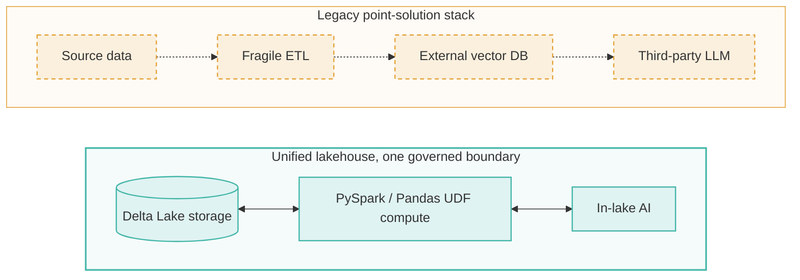
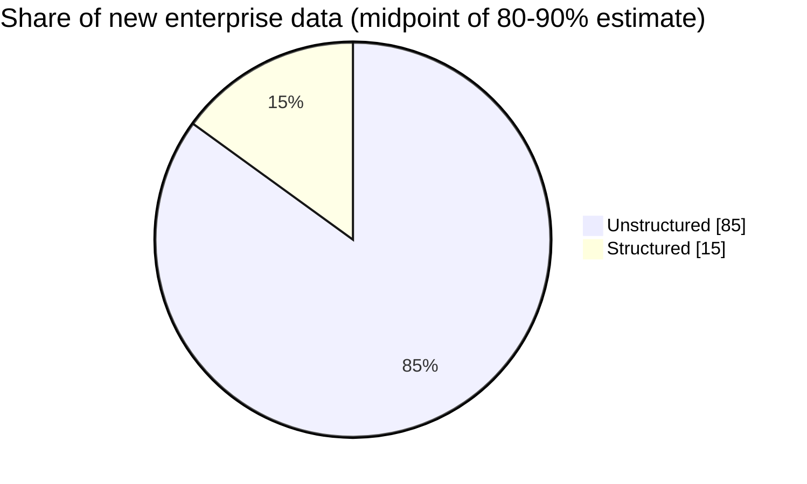
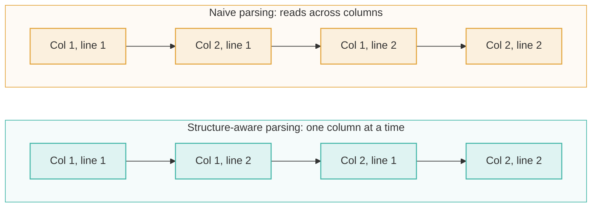
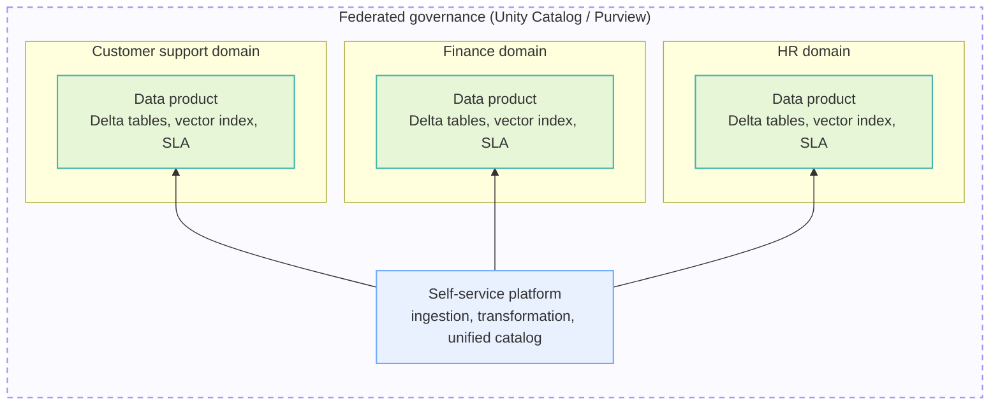

---


---

## Introduction: The Enterprise AI Infrastructure Paradox

Generative AI promises to revolutionize enterprise operations, from customer support automation and legal compliance to internal knowledge management. Yet when data engineers and enterprise architects try to bring Retrieval-Augmented Generation (RAG) into production, they often run into a frustrating paradox.

Instead of streamlining operations, traditional implementations yield bloated, complex architectures. Engineering teams find themselves provisioning specialized, standalone vector databases, writing fragile ETL pipelines, and moving sensitive enterprise files across ungoverned cloud perimeters. This architectural sprawl increases external licensing costs, introduces synchronization latency, and creates severe security risks.



*Legacy stack: high licensing costs, data sprawl, CDC sync latency, fragmented security. Lakehouse: zero data movement, ACID transactions, one governance layer.*

The core premise of modern AI engineering is simple: **you do not need a massive, fragile infrastructure stack to deploy high-performing RAG and enterprise AI.** Modern data platform patterns allow compute, storage, vector search, and AI inference to coexist within a single governed analytical boundary.

Below are five counter-intuitive truths that challenge legacy assumptions and outline a simpler, more resilient path for building enterprise-grade AI data pipelines.

## Takeaway 1: You Don't Need a Standalone Vector Database for Enterprise RAG

A widespread assumption among engineering teams is that production RAG applications strictly require specialized external vector databases running complex index structures like HNSW or IVF. In practice, native Lakehouse environments, such as Databricks Delta Lake or Microsoft Fabric OneLake, can perform distributed embedding generation and cosine similarity search directly on open Delta Parquet tables using PySpark and PyArrow-accelerated Pandas UDFs, often in under 50 lines of Python.

By defining a vectorized Pandas UDF with `@pandas_udf("array<float>")`, Apache Spark distributes text chunk processing across cluster nodes. PyArrow serialization moves data efficiently between JVM memory and Python workers, allowing batched API calls to embedding models (such as Azure OpenAI `text-embedding-ada-002`) without the overhead of row-by-row Python serialization. The resulting high-dimensional arrays are written directly as `array<float>` columns inside Gold-layer Delta tables (such as `Gold_Lakehouse.SupportVectors`).

```python
# PySpark Distributed In-Lake Vectorization Pattern
import openai
import pandas as pd
from pyspark.sql.functions import col, pandas_udf

@pandas_udf("array<float>")
def generate_embeddings(text_series: pd.Series) -> pd.Series:
    def get_embedding(text):
        response = openai.Embedding.create(
            input=text, engine="text-embedding-ada-002"
        )
        return response['data'][0]['embedding']
    return text_series.apply(get_embedding)

# Read raw customer transcripts directly from Gold Delta layer
df_logs = spark.read.table("Gold_Lakehouse.CustomerSupportTranscripts")

# Distributed vectorization and persistence to Delta Parquet
df_vectorized = df_logs.withColumn("VectorEmbedding", generate_embeddings(col("TranscriptText")))
df_vectorized.write.format("delta").mode("overwrite").option("vorder", "true").saveAsTable("Gold_Lakehouse.SupportVectors")
```

Executing vector workflows natively within the Lakehouse provides four major operational advantages:

- **Zero Data Movement:** Raw data, generated vector arrays, and prompt context remain strictly inside your analytical perimeter.
- **Storage-Level Optimization via V-Order:** Enabling V-Order compression reorganizes Delta Parquet files at write time. This optimizes in-memory file layout and accelerates downstream array scans during vector similarity queries.
- **Incremental Vectorization via Delta CDC:** Delta Lake Change Data Capture (CDC) and transaction logs let pipelines isolate newly inserted or modified rows, so only incremental changes are vectorized instead of running costly full-table re-embedding passes.
- **Strict ACID Transactions:** Delta Lake guarantees transactional integrity, keeping vector array columns synchronized with source document mutations.

> "Rather than exporting unstructured transcripts to a third-party vector database, we construct a unified pipeline where storage, compute, and AI inference coexist seamlessly... without moving a single byte outside our analytical perimeter."

## Takeaway 2: 80% to 90% of Your Data Is Unstructured, and Your Architecture Is Ignoring It

For decades, enterprise data architectures were built around structured transactional records: clean rows and columns flowing into warehouses for SQL-based business intelligence. However, industry analysis synthesized from Dataversity and Informatica shows that **80% to 90% of new enterprise data is unstructured**.



Customer support audio, contracts, clinical records, scanned PDFs, and HTML documentation represent an organization's true core knowledge. Ignoring this content creates *analytical poverty in the midst of data abundance*. When unstructured files are pushed into isolated object stores with fragmented access controls, enterprises face severe operational friction:

- **Cross-Modality Analytics Silos:** Correlating a structured customer claim row with scanned damage photos and call transcripts becomes an impossible manual process.
- **Duplicated Processing Overhead:** Independent teams re-parse and re-clean the exact same source documents for search, compliance, and analytics.
- **Inconsistent Governance Posture:** Privacy rules, HIPAA compliance, and GDPR deletion requests are applied unevenly across relational databases versus unindexed document folders.

### The Multimodal Lakehouse

To overcome this fragmentation, modern data strategies must move to a **Multimodal Lakehouse**. This approach treats unstructured files as first-class queryable assets alongside relational tables by pairing unified ingestion with intelligent AI extraction.

For table-heavy documents (like financial filings or insurance policies), production pipelines extract complex layout structures into raw HTML canonical representations rather than flattening them to plain text or Markdown. Storing HTML strings inside Delta columns preserves nested headers, explicit layout boundaries, numeric matrix alignment, and footnote associations. This structural preservation lets downstream LLMs reason accurately over financial totals and fine-print qualifiers without misreading table relationships.

## Takeaway 3: Naive Chunking and Missing Metadata Will Ruin Your RAG App Faster Than a Bad LLM

When enterprise RAG applications deliver poor or inaccurate answers, engineering teams often default to swapping out the downstream Large Language Model. In practice, failure is almost always caused by upstream preprocessing mistakes: flawed document parsing, arbitrary chunking, missing metadata, and failure to deduplicate content.

### High-Failure Document Formats in Production

Production benchmarks show that scanned PDFs, slide decks, and multi-column layouts have the highest RAG failure rates. Naive optical or text parsers misread multi-column reading order, mixing adjacent text blocks and severing logical clause boundaries before the text even reaches the chunking stage.



### Advanced Preprocessing Patterns

To build a resilient retrieval layer, architects must eliminate naive character-count chunking (e.g., hard 100-token cutoffs) and implement three disciplined preprocessing techniques:

1. **Format-Specific & Semantic Chunking:** Split documents along natural structural boundaries using Markdown header tags (`#`, `##`), HTML section dividers, or topic-boundary shifts.
2. **Four-Step Deduplication via Spark ML MinHash:** Duplicate files across shared drives pollute vector indexes with redundant chunks. Production pipelines run a concrete Locality-Sensitive Hashing (LSH) pipeline:
   - **Step 1 – N-gram Tokenization:** Convert parsed document text into feature vectors using tokenization, stop-word filtering, and character n-grams.
   - **Step 2 – MinHash Model Fitting:** Fit a `MinHashForJaccardDistance` model in Spark ML to hash feature vectors into low-dimensional representations.
   - **Step 3 – Similarity Join:** Perform a similarity join across hash tables to identify document pairs exceeding a target Jaccard similarity threshold (e.g., > 0.85).
   - **Step 4 – Threshold Filtering:** Filter near-duplicate pairs and keep only the authoritative or most recently updated source document.
3. **Identity-Aware Metadata Filtering:** Store granular RBAC security tags, source URIs, creation timestamps, and data sensitivity classifications (e.g., PII/HIPAA) directly alongside vector arrays. Security filters are evaluated before prompt assembly, preventing unauthorized context from entering the LLM window.

> "If metadata is missing or inconsistent, a correct answer can be blocked by access control or returned without provenance... Parsing errors that change reading order or break table structures are the leading cause of downstream RAG failure."

## Takeaway 4: Fine-Tuning Is for Behavior; RAG Is for Knowledge

A common architectural misstep is treating Fine-Tuning and Retrieval-Augmented Generation as competing ways to expose company data to an LLM. In enterprise system design they play fundamentally different roles: **fine-tuning adapts model behavior, while RAG provides dynamic model knowledge.**

| Architectural Dimension | Fine-Tuning | Retrieval-Augmented Generation (RAG) |
|---|---|---|
| **Primary Purpose** | Enforcing stable behavior, specialized output formatting, tone, style, or custom JSON schemas. | Injecting dynamic, accurate enterprise knowledge into the prompt context at request time. |
| **Knowledge Currency** | Static; frozen at training time. Updating facts requires re-training. | Dynamic; real-time. Immediately reflects edits, deletions, or new uploads in the underlying Delta tables. |
| **Auditability & Provenance** | Low; internal weights act as a "black box" without direct source citations. | High; returns exact source document URIs, chunk IDs, and verifiable citations. |
| **Access Control & Permissions** | Hard; user permissions cannot easily be encoded into or masked within neural weights. | Native; identity-aware metadata filtering blocks unauthorized content before prompt assembly. |

If your pipeline needs an LLM to consistently produce specialized legal responses in a strict JSON schema, fine-tune the model. If your application must answer questions based on frequently updated, access-controlled internal policies, build a RAG pipeline over your Lakehouse.

## Takeaway 5: Centralized Data Teams Are the Ultimate Bottleneck for Enterprise AI

Historically, enterprise IT managed data through a monolithic, centralized team. Every new ETL pipeline, table change, or vector indexing request had to pass through a single queue. As AI initiatives scale across Finance, HR, Marketing, and Customer Support, this centralized structure becomes an unmanageable bottleneck.

To scale AI capabilities, organizations must move to a **Data Mesh for AI** architecture built on four guiding principles:



*Federated governance covers PII classification, masking and access tracking. Each domain owns and publishes its own data product.*

1. **Data as a Product:** Business domains publish discoverable, high-quality data assets, including vectorized Delta tables and documented RAG indexes, with published SLAs via data marketplaces (such as Informatica Cloud Data Marketplace or Databricks Marketplace).
2. **Decentralized Domain Ownership:** Subject-matter experts in Finance, Legal, or Support own and maintain their domain-specific pipelines, so datasets reflect domain nuances.
3. **Federated Governance:** Central IT defines enterprise security policies, enforcing automated PII classification, dynamic data masking, and access tracking with tools like Unity Catalog or Microsoft Purview, while domain teams enforce access controls locally.
4. **Self-Service Infrastructure:** Platform engineering provides standardized self-service tooling, such as automated ingestion connectors, drag-and-drop transformation engines, and unified catalogs, so domain teams can build end-to-end AI pipelines independently.

## Conclusion & Looking Ahead

Building enterprise-grade AI applications does not require stacking fragile point solutions on top of legacy architectures. Real engineering efficiency comes from simplifying your core infrastructure:

- **Unifying Storage:** Use Multimodal Lakehouses to store structured metrics and unstructured documents side by side in open file formats.
- **Keeping Retrieval In-Lake:** Run vector generation and similarity search directly on open Delta Parquet tables using `@pandas_udf` functions, V-Order compression, and CDC-driven incremental processing.
- **Fixing Upstream Preprocessing:** Prioritize high-fidelity layout parsing, HTML table representation, Spark ML MinHash deduplication, and identity-aware metadata filtering over swapping downstream LLMs.
- **Decentralizing Management:** Adopt Data Mesh principles to empower business domains while keeping centralized, federated governance.

As you evaluate your AI roadmap for the coming year, ask yourself: **Are you building a resilient, unified foundation for your enterprise data, or just adding another layer of complex point solutions that your engineering team will eventually have to tear down?**

