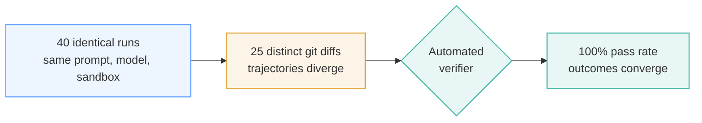
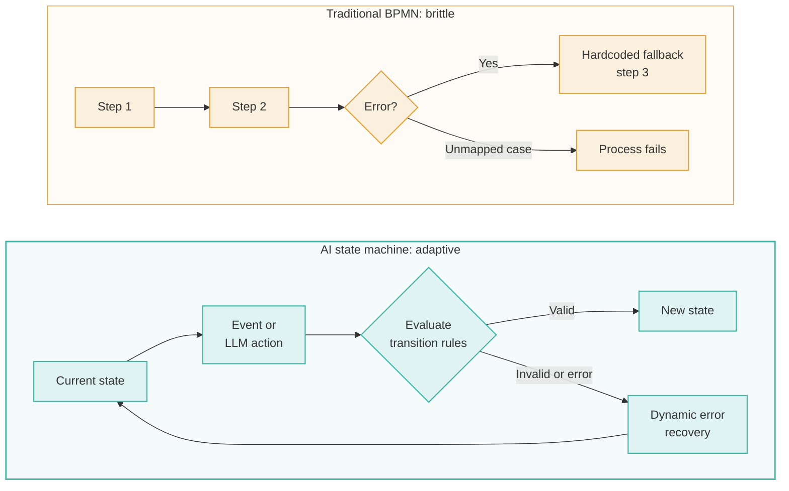
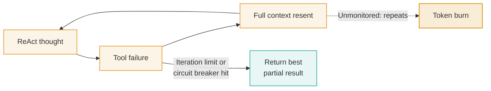
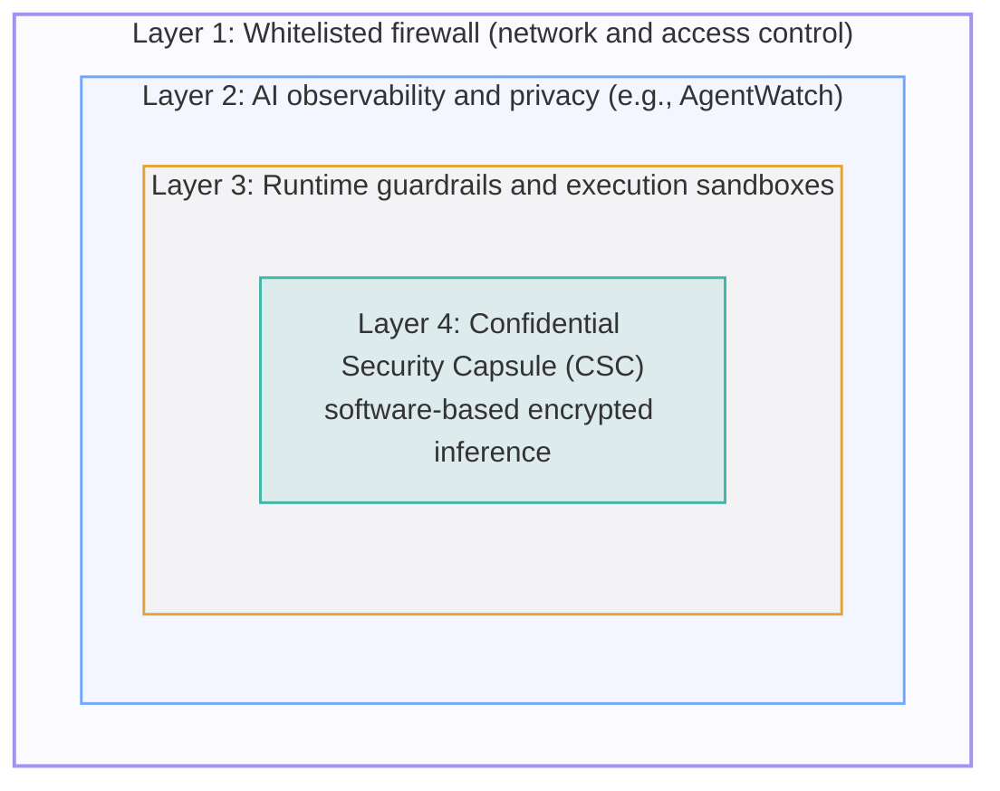
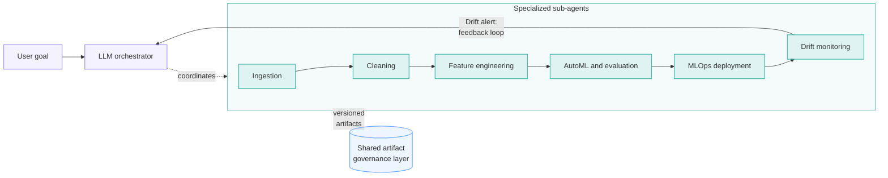

---


---

## Introduction: The Enterprise AI Paradox

The enterprise AI landscape in 2026 presents a striking paradox. Organizations are rushing to deploy autonomous agents across core operations, driven by promises of end-to-end automation. Yet according to Gartner projections, **over 40% of agentic AI projects will be canceled by the end of 2027** due to escalating cloud costs, weak operational controls, and premature architectural complexity.

The path from an impressive single-prompt chatbot demo to a reliable, multi-agent enterprise system is full of failure modes that traditional software engineering never prepared us for. Moving past the hype means rethinking how we organize, govern, and observe autonomous systems.

This post distills six counter-intuitive, empirical takeaways from leading technical research and whitepapers, including findings from Iterate.ai, AgentField, Automation Anywhere, and recent academic research on Big-Data-as-a-Service (BDaaS) multi-agent architectures. Whether you are scaling your first agentic workflow or refactoring a sprawling multi-agent system, these takeaways offer architectural blueprints for building production-grade AI systems that scale securely.


## Takeaway 1: Stop Over-Engineering. The Right Pattern Beats a Bigger Model

The most common mistake in enterprise AI adoption is reaching for complex multi-agent swarms before exhausting what a well-engineered single agent can do. Teams often assume a harder business problem needs either a bigger foundation model or an unstructured network of collaborating agents. In practice, **the structure of the execution loop dictates reliability far more than raw model scale.**

Agentic design patterns fall along a six-tier complexity ladder:

| Tier | Category | Example patterns |
|---|---|---|
| 1 | Foundation | Single-agent tool callers, ReAct loops, prompt chaining, least-to-most decomposition |
| 2 | Routing and flow control | Intent classifiers/dispatchers, dynamic handoffs, scatter-gather parallelization, evaluator-optimizer loops |
| 3 | Planning and search | Plan-and-execute, ReWOO, Tree of Thoughts, Language Agent Tree Search |
| 4 | Memory and learning | Short/long-term memory, Reflexion (verbal reinforcement), skill libraries |
| 5 | Knowledge and tools | Tool marketplaces, agentic RAG, knowledge-graph reasoning |
| 6 | Multi-agent orchestration | Orchestrator-workers, group chat/debate, hierarchical decomposition, swarm architectures |

Most enterprise tasks, including many that first appear to need a multi-agent team, can be solved reliably at **Tier 1 or Tier 2** with structured prompts, tight tool definitions, and clear boundaries.

> "The difference between a demo and a production agent is not the model—it is the orchestration pattern. The right pattern turns an expensive, unreliable prototype into a system that your organization can trust, observe, and scale." — Anthropic (2025)

To build robust Tier 1 implementations, enforce strict operational constraints:

1. **Constrain toolsets:** Limit an agent to 10–15 tools at most. Selection accuracy degrades significantly when LLMs face overly broad tool registries.
2. **Enforce structured outputs:** Require JSON-mode structured outputs for all tool invocations to eliminate string-parsing failures and schema mismatches.
3. **Implement timeouts and retries:** Set explicit per-tool timeouts and retry logic so an isolated API failure doesn't hang the entire reasoning loop.

**Recommendation:** Always start at the bottom of the ladder with a single-agent tool caller or ReAct loop. Add routing, evaluation, or multi-agent orchestration only when you hit concrete, measurable limits that lower tiers cannot resolve.

## Takeaway 2: Trajectories Diverge, Outcomes Converge. Understanding "Variance Absorption"

When orchestrating harness-based autonomous agents (such as coding or execution agents working in a workspace), architects must accept a fundamental shift: **harness orchestration is closer to organizational design and managing people than to writing procedural code.** You cannot program an agent's internal reasoning; you can only engineer membranes, set explicit contracts, and build verifiers around autonomous units.

In code, this is the difference between a single-shot **constrained call** and an **autonomous harness loop**:

```python
# CONSTRAINED CALL: Single-shot, stateless token generation
result = await app.ai(
    system="Classify incoming support request.",
    user=ticket_text,
    schema=TicketClassification,
    model="openai/gpt-4o-mini"
)

# HARNESS LOOP: Autonomous execution, durable workspace, verified outcome
result = await app.harness(
    prompt="Implement JWT authentication on /checkout. Ensure pytest -q passes.",
    cwd="/srv/app/worktree",
    provider="claude-code",
    model="anthropic/claude-sonnet-4-5",
    max_turns=30,
    max_budget_usd=5.00
)
```

This shift relies on **variance absorption**: the ability of an agent harness to absorb a wide range of problem variations without changing the shape of the top-level API call. A harness primitive is defined by three orthogonal properties:

1. **Agency:** Does the unit initiate its own sequence of actions? (Yes, it decides its internal steps.)
2. **Embodiment:** Does the unit act on the environment? (Yes, it writes files, runs shell commands, and calls external APIs.)
3. **Persistence:** Does state carry across time? (Yes, state persists across turns via the filesystem and memory.)

| Property | Constrained call (`.ai()`) | Harness loop (`.harness()`) |
|---|---|---|
| **Agency** (initiates work?) | No. Invoked step by step by an external caller. | Yes. Autonomous internal reasoning loop. |
| **Embodiment** (acts on the world?) | No. Returns a pure text/JSON payload. | Yes. Writes files, runs processes, calls APIs. |
| **Persistence** (carries state?) | No. Completely stateless per call. | Yes. State persists via workspace and memory. |
| **Invocation shape** | Single-shot function signature. | Goal-based workspace execution. |
| **Verification basis** | Schema validation on token output. | Automated verifier checks on environmental artifacts. |

In an empirical benchmark by AgentField, 40 identical invocations of a software engineering task (same prompt, same model, fresh sandbox each time) produced **25 distinct git diffs**. Yet because every run was governed by an automated test-harness verifier, the system achieved a **100% pass rate**.



LLMs also show natural **attractor states**: solutions the model keeps returning to because of its pre-training priors. In the 40-trial experiment, one specific diff (`7a29755d`) recurred 9 times, while 19 other diffs appeared only once.

The key insight is that **architecture is the variance absorber across model tiers.** In standardized benchmarks, the same harness architecture scored 95/100 on both Claude Haiku and a significantly cheaper open-source model. A robust harness with tight verifiers compensates for model gaps: system design, not raw model spend, absorbs task variance.

## Takeaway 3: BPMN Is Dead for AI. Why Event-Driven State Machines Dominate

For decades, enterprise business process management relied on **Business Process Model and Notation (BPMN)**: fixed, procedural flowcharts where every path, branch, and error handler is hardcoded at design time. Applied to agentic AI, traditional BPMN breaks down. LLM reasoning is dynamic and probabilistic, and forcing an agent into a rigid, linear flowchart produces brittle systems that fail whenever an unmapped edge case appears.

Enterprise orchestration frameworks (such as Automation Anywhere's Mozart Orchestrator) have shifted to **event-driven state machines**. Instead of defining step-by-step paths, a state machine bounds the valid system states, conditions, and allowed transitions, while permitting dynamic reasoning at runtime within those bounds.



| Dimension | Traditional BPMN | AI state machines |
|---|---|---|
| **Execution structure** | Sequential, deterministic flowcharts with predefined paths. | Dynamic, state-driven transition graphs that evaluate context at runtime. |
| **Adaptability** | Fails immediately on unmapped edge cases or unstructured data variations. | Evaluates real-time context and inputs to choose a valid transition. |
| **Exception handling** | Needs an explicit, hardcoded error branch for every failure mode. | Uses reasoning-based fallback, automated retries, and context-aware recovery loops. |
| **State memory** | Simple process-level variable tracking. | Granular, context-engineered global state backed by vector stores and key-value databases. |

By pairing state machines with centralized state management, long-running agent workflows can pause for human input or external events and resume seamlessly, without losing context or blowing up context windows.

## Takeaway 4: The Silent Killers of AI Budgets: Token Burn and Agent Sprawl

As multi-agent architectures scale from pilot to production, the main risks shift from output accuracy to governance and cost control. Two silent killers threaten enterprise AI budgets:

1. **Agent sprawl:** Unmonitored deployment of redundant autonomous agents across teams without central registration. Sprawl leads to duplicate API queries, race conditions over shared data, and conflicting downstream actions.
2. **Token burn:** Rapid cost escalation from agents stuck in infinite reasoning loops, context-window bloat (resending huge conversation histories every turn), or continuous retries against failing external APIs.



To protect the budget, engineering teams must deploy firm operational controls:

- **Hard iteration limits:** Cap reasoning loops strictly (e.g., 5–10 iterations for ReAct loops).
- **Graceful degradation:** When iteration limits or circuit breakers are hit, the orchestrator should return the best partial result rather than throw an unhandled exception or crash the pipeline.
- **Sliding-window context summarization:** Separate transient working memory from global process state. Periodically compress old context and pass only the instructions each sub-task needs.
- **Circuit breakers and hard timeouts:** Automatically kill agent tasks when token use or runtime exceeds predefined budget thresholds.
- **Centralized observability:** Mandate enterprise tracing tools (such as Iterate.ai's AgentWatch) that log unique trace IDs across multi-agent pipelines and track token usage, latency, and cost per task.

## Takeaway 5: Defense-in-Depth Is Mandatory for Autonomous Systems

Deploying open-source agent frameworks (such as OpenClaw and basic community templates) with default settings creates severe enterprise security vulnerabilities. Out of the box, many open-source tools ship with permissive defaults: unrestricted file access, unsandboxed shell execution, missing input/output filters, and broad API privileges.

Autonomous agents introduce attack vectors that traditional application security cannot mitigate, including **prompt injection, unauthorized tool execution, context poisoning, and cross-session memory leaks.**

Securing autonomous enterprise systems requires a multi-layered **defense-in-depth** model:



1. **Whitelisted firewalls:** Restrict network traffic to verified external domains and APIs only.
2. **AI observability and privacy enforcement:** Intercept payloads in real time (with platforms like AgentWatch) to enforce data loss prevention (DLP) and redact sensitive corporate data.
3. **Runtime guardrails and sandboxes:** Run tool commands inside isolated runtime containers (e.g., isolated worktrees or Docker sandboxes) with strict filesystem allowlists.
4. **Confidential Security Capsules (CSC):** Run inference inside isolated, encrypted sessions. CSC is a software-based protection layer, not hardware-dependent, so it can be deployed across any public cloud or on-premise environment without hardware enclaves.

**Human-in-the-loop (HITL) approval gates are not optional convenience features; they are vital security controls.** High-risk operations, such as financial transactions, infrastructure changes, or data deletion, must pause execution and present the agent's full reasoning to a human reviewer before any real-world tool is invoked.

## Takeaway 6: Full Lifecycle Governance: Integrating Data, AutoML, MLOps, and Drift Awareness

Focusing agentic design only on isolated task execution creates hidden technical debt (Sculley et al.). Recent academic research into self-composable Big-Data-as-a-Service (BDaaS) multi-agent frameworks shows that production-grade systems must govern the entire lifecycle of data, models, and deployments.

Rather than relying on isolated prompts, advanced enterprise pipelines deploy specialized sub-agents coordinated by a central orchestrator:



- **Data ingestion and cleaning agents:** Profile schemas, handle missing values and format inconsistencies, and flag tabular outliers.
- **Feature engineering agents:** Perform semantic and statistical feature transformations and encodings.
- **AutoML and evaluation agents:** Run model selection, hyperparameter tuning, and independent validation against reliability criteria.
- **MLOps deployment agents:** Package approved models into versioned API container services with explicit preprocessing artifacts.
- **Monitoring and drift detection agents:** Continuously track prediction distributions, latency, data drift, and concept drift after deployment.

Single-agent LLM approaches fail in production because schema changes or covariate drift cause silent failure cascades. To prevent this, specialized agents work through a **shared artifact governance layer**. This layer is the single source of truth, versioning raw data, schemas, feature matrices, trained model binaries, evaluation reports, and containerized deployment configs.

When post-deployment monitoring detects distribution drift, a **drift-aware feedback loop** sends automated alerts back to the orchestrator, triggering automated re-cleaning, retraining, verification, and controlled redeployment or rollback without manual engineering intervention, eliminating hidden technical debt entirely.

## Conclusion & Forward-Looking Thought

Moving from agentic AI hype to sustainable enterprise value means treating orchestration, verification, security, and governance as first-class architectural primitives. As technical leaders prepare their systems for 2026 and beyond, success depends on five mental shifts:

- **From model size to orchestration patterns:** Optimize the execution loop before upgrading foundation models.
- **From prompt engineering to membrane engineering:** Focus on tool sandboxes, workspace limits, and output schemas rather than tweaking system-prompt wording.
- **From driving steps to verifying outcomes:** Embrace variance absorption; give agents execution autonomy while building rigorous automated verifiers.
- **From BPMN flowcharts to event-driven state machines:** Build dynamic, state-aware graphs that can recover from unmapped edge cases.
- **From task automation to full-lifecycle governance:** Integrate shared artifact versioning and drift-aware feedback loops across data, training, and deployment.

Is your current AI architecture built for demo-day novelty, or is it engineered for **enterprise-grade resilience, governance, and scale**?

