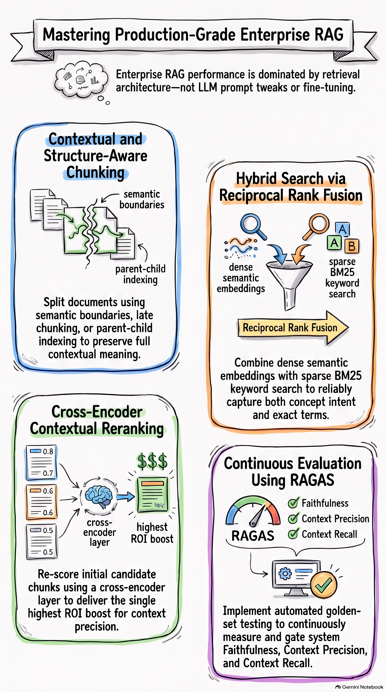
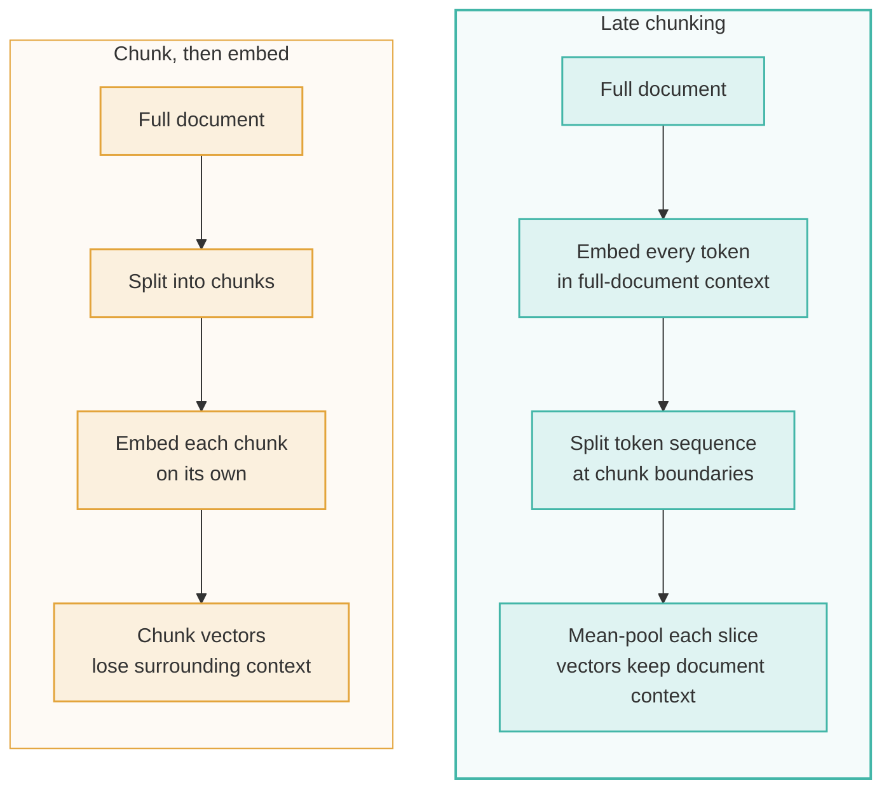
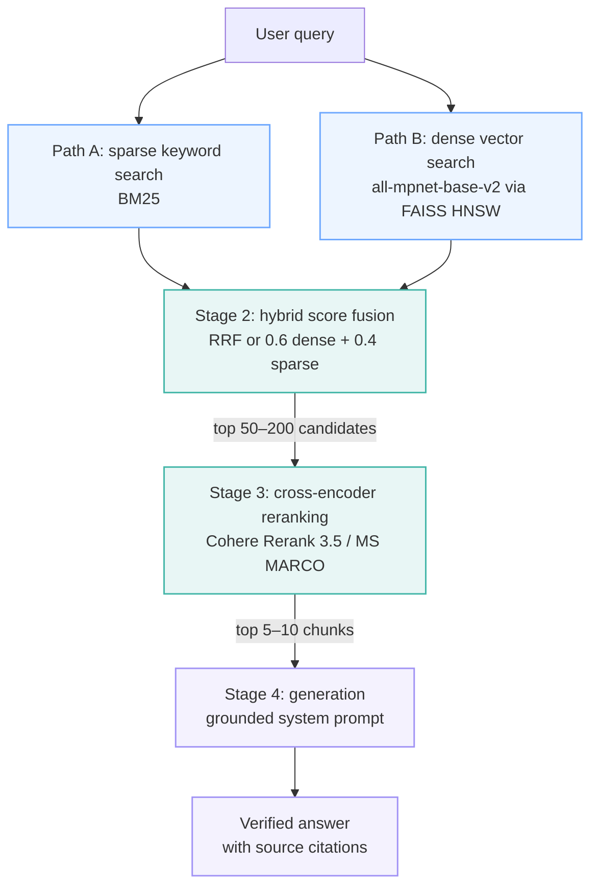
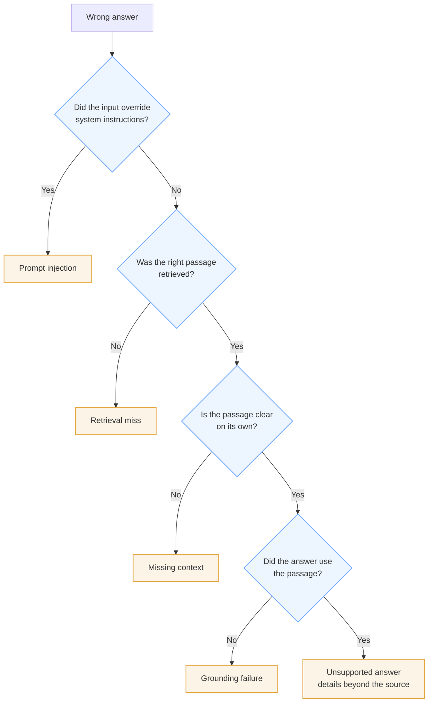

---

Most Retrieval-Augmented Generation (RAG) proof-of-concepts work brilliantly in early demos. You feed a few clean PDFs into a vector database, wire up a top-tier Large Language Model (LLM), and watch it answer questions about your documents with ease. The executive team is impressed, and the project is greenlit for enterprise production.

Then comes actual deployment.

Answers that seemed bulletproof in testing start contradicting source materials, or the system confidently cites policy sections that don't exist. End users get severed context, hallucinated references, and authoritative wrong answers. This gap between an impressive prototype and an operational enterprise system is the **Production RAG Gap**.

The core premise engineering teams must confront is simple: **high-performance RAG is an architectural engineering challenge, not a prompt-engineering or model-swapping fix.** Upgrading your generative LLM will not compensate for broken upstream retrieval. Drawing on production deployments, empirical benchmarks, and architectural research, this post distills seven counter-intuitive, high-impact takeaways that separate enterprise-grade RAG pipelines from fragile prototypes.

## 1. The Model Fallacy: Parsing and Chunking Dictate 80% of Your System's Accuracy

Engineering teams routinely spend months benchmarking the newest foundation models or testing alternative embedding architectures when their RAG pipeline underperforms. Yet in production enterprise environments, the primary bottleneck is almost never the model. It is upstream document ingestion.

When raw documents enter an ingestion pipeline, standard character-based splitters process text blindly. Complex enterprise formats, such as multi-column PDFs, nested financial tables, presentations with non-linear visual flow, and technical documentation containing code blocks, frequently break under naive splitting. The result is unstructured "topic soup": fragments where structural hierarchy is destroyed, section headers are severed from body text, and row-column associations in complex tables are flattened.

If the ingestion layer fails to parse tables or loses document layout logic, no downstream vector model or LLM can reconstruct the missing facts. To extract structured tables reliably, production pipelines use specialized tooling such as **Camelot** or **pdfplumber** for text and table serialization, or enterprise layout engines such as **Azure Document Intelligence**.

Once text is extracted, chunk parameters must be calibrated deliberately. Rather than relying on arbitrary character limits, enterprise pipelines typically use:

| Parameter | Typical setting |
|---|---|
| Chunk size | 300–500 tokens (or roughly 700 characters) |
| Overlap | 10%–20% (50–100 tokens) |
| Separator priority | Heading > Paragraph > Sentence |
| Vector index | FAISS HNSW with `M=32`, `efConstruction=200`, `efSearch=50` |

Engineers naturally gravitate toward generative models, where prompt changes produce immediate, visible output shifts. However, unglamorous data preparation and document parsing deliver the highest return on investment (ROI).

> "Document parsing quality has a far greater impact on final performance than model selection or retrieval algorithm optimization." — Tencent Cloud ADP

## 2. The Context Isolation Trap (and Why "Late Chunking" Flips the Script)

Traditional chunk-then-embed pipelines suffer from **context isolation**, which triggers "Missing Context" errors. When a long document is cut into isolated token windows before embedding, critical semantic dependencies are orphaned.

For example, if a passage states, *"The system supports up to 10,000 concurrent users,"* a standard chunker embeds that sentence as an isolated chunk. Once it is separated from the section heading that says which middleware product or infrastructure tier is being described, the retrieved chunk becomes ambiguous or useless.

Two advanced strategies address this trap:

1. **Contextual Retrieval:** Before indexing, a lightweight LLM reads each chunk in relation to the whole document and generates a 50–100 token metadata summary. This summary, containing the document title, H1/H2/H3 section path, parent domain, and primary entity tags, is prepended to the chunk text before vectorization.
2. **Late Chunking** (Jina AI, [arXiv 2409.04701](https://arxiv.org/abs/2409.04701)): This approach reverses the usual sequence. Instead of splitting text first and embedding each piece independently, the entire document is passed through a long-context embedding model first. The model computes token embeddings across the complete document. Only then is the token sequence split at chunk boundaries, with mean-pooling applied to each slice.



Because every chunk embedding produced by late chunking is computed with attention across the entire document, long-distance semantic dependencies survive. This resolves the classic failure mode where isolated chunks lose their antecedent context.

> "Late chunking is the first genuinely new idea in RAG retrieval in two years. Everything else is tuning." — Explore Agentic

## 3. Vector Search Alone Is a Production Liability: Hybrid Search Is Mandatory

A common misconception in early RAG design is that dense vector search (semantic similarity) is a complete retrieval solution. In production, relying only on dense embeddings is a critical vulnerability.

Dense vector models excel at capturing broad semantic intent (for example, mapping "earnings report" to "financial performance"), but they systematically fail when queries require lexical precision:

- Exact part numbers, serial codes, or product SKUs (e.g., `XR-7200-v2`)
- Precise software error codes and API method names
- Specialized industry jargon or legal clause numbers
- Strict negation constraints (e.g., "supported features except in region EU")

Sparse keyword search such as **BM25** excels at exact term matching and entity alignment, though it struggles with conceptual rephrasing. Enterprise production standards therefore call for a **hybrid retrieval pipeline** that runs dense vector search and sparse BM25 search in parallel.

Candidate sets are fused either with **Reciprocal Rank Fusion (RRF)** or with empirical score weighting:

```text
score = 0.6 × score_dense + 0.4 × score_sparse
```

Benchmarks highlight the impact: systems using advanced hybrid retrieval answer roughly **63%** of factual questions correctly, compared with **44%** for naive single-strategy vector search. That 19-point gap is the boundary between operational utility and enterprise risk.

## 4. Cross-Encoder Rerankers Are the Single Highest-ROI Upgrade Most Teams Skip

Standard vector retrieval relies on **bi-encoder** architectures: queries and passages are embedded independently, which allows ultra-fast dot-product search over millions of records.

Think of bi-encoder search as a high-speed database index lookup. It scans multi-million-item spaces in milliseconds to return a broad candidate pool of the top 50–200 items, but its semantic scoring is coarse. A second-stage **cross-encoder reranker** (such as Cohere Rerank 3.5 or MS MARCO fine-tuned models) works more like a deep inspection pass: it processes the query and each candidate passage *jointly*, scoring full semantic agreement, and narrows the pool to the 5–10 most precise chunks.

The enterprise retrieval and reranking pipeline runs in four stages:



Adding a second-stage cross-encoder removes noise before context is stuffed into the generation window. Evaluation results show gains across all major retrieval metrics:

| Retrieval metric | Naive vector search baseline | Hybrid + cross-encoder pipeline |
|---|---|---|
| Precision@5 | 75% | 90% |
| Recall@5 | 74% | 87% |
| Mean Reciprocal Rank (MRR) | 0.69 | 0.85 |

Paying a small latency cost, typically a few hundred milliseconds for cross-encoding, saves thousands of downstream generation tokens, reduces context bloat, and sharpens accuracy.

> "Model choice is the conversation everyone wants to have. Chunking and re-ranking are the changes that actually move the benchmark." — Explore Agentic

## 5. Stop Blaming "Hallucinations": Diagnosing the 5 Distinct RAG Failure Modes

Labeling every incorrect output as a generic "hallucination" leads to the wrong architectural fixes. When a RAG system gives an inaccurate response, teams must isolate the exact failure point across five distinct modes:

1. **Retrieval Miss (recall issue):** The system failed to fetch the correct source passage. The LLM answered incorrectly because the evidence was never in the prompt context.
2. **Missing Context (isolation issue):** The correct chunk was retrieved, but severed context makes the passage ambiguous or uninterpretable to the generator.
3. **Grounding Failure:** The LLM received the correct context but ignored it, falling back on its static pre-training memory.
4. **Unsupported Answer (extrapolation):** The LLM had relevant content but fabricated details beyond what the source said (e.g., claiming a "47% increase" when the source only noted "strong growth").
5. **Prompt Injection:** Malicious or accidental input overrode system instructions and compromised generation safeguards.



System design requires diagnosis before treatment. Better prompts will not fix a retrieval miss, and a new embedding model will not resolve grounding failures.

To govern performance continuously, production teams use automated evaluation frameworks such as **RAGAS** (Retrieval-Augmented Generation Assessment), tracking four core metrics:

- **Faithfulness:** are the answer's claims supported by the context?
- **Context Precision:** the signal-to-noise ratio of retrieved chunks.
- **Context Recall:** was all the required evidence retrieved?
- **Response Relevancy:** does the answer directly address the user's intent?

When confidence thresholds or RAGAS scores drop, the system must **fail closed**: refuse to guess and return an explicit message such as *"I cannot find sufficient authoritative context to answer this query reliably."*

## 6. The Hidden "Context Tax": How Bigger Chunks Hurt Throughput and Latency

To improve recall, architects often increase chunk size (from 256 to 512 or 1,024 tokens) or retrieve larger Top-K sets. Hardware scaling benchmarks reveal severe trade-offs in GPU memory, prefill latency, and overall system throughput.

Larger chunks inflate the **Input Sequence Length (ISL)** sent to the LLM. On GPUs, this prompt bloat acts as an exponential "KV-cache memory tax" during the prefill phase:

- **Time-to-First-Token (TTFT):** Doubling chunk size (e.g., 256 → 512 or 512 → 1,024 tokens) roughly doubles TTFT prefill latency for active users.
- **System throughput:** For every additional 1,000 tokens of ISL, output throughput (tokens per second or requests per second) drops by 25% to 50%.

The impact varies by latency regime:

| Target latency regime | TTFT SLA target | Throughput drop per +1,000 ISL tokens |
|---|---|---|
| Low latency | TTFT < 3 s | Up to 25% |
| Balanced performance | 3 s ≤ TTFT ≤ 5 s | Up to 33% |
| Max throughput | TTFT > 5 s | Up to 50% |

Architects should design for **balanced performance**, operating at the "knee of the curve" where the product of output throughput × per-user throughput is maximized. Feeding oversized context windows into LLMs degrades throughput and inflates GPU spend without proportional accuracy gains.

## 7. Agentic RAG Is an Expensive Tax Unless Your Queries Require Multi-Hop Reasoning

Agentic RAG places retrieval inside an autonomous planning and reasoning loop. Using tool-calling LLMs, agentic systems perform dynamic query rewriting, sub-query decomposition, multi-turn tool use, and iterative evaluation before producing an answer.

Agentic loops are a powerful evolutionary step, but deploying them for standard enterprise document search is an expensive anti-pattern. Agentic RAG earns its keep only under specific conditions:

- **Multi-hop reasoning:** queries that require retrieving, synthesizing, and joining data across multiple documents or repositories.
- **Cross-corpus analysis:** workflows that query unstructured document stores, relational SQL databases, and live external APIs at the same time.
- **Ambiguous user intent:** complex requests that need multi-turn clarification before execution.

For standard single-turn factual lookups, wrapping retrieval in an agentic loop is a performance tax: it adds seconds of latency and substantial token cost without improving precision or recall.

## Conclusion: Engineering the Future of Enterprise Knowledge

Reliable enterprise RAG is not achieved through prompt magic or constant foundation-model upgrades. It comes from a disciplined, end-to-end retrieval stack built on:

1. **High-precision document parsing** (Camelot, pdfplumber, Azure Document Intelligence) that preserves table and layout structure.
2. **Structure-aware contextual chunking** (late chunking and prepended metadata summaries) that preserves document-wide semantic dependencies.
3. **Hybrid search** (dense vector similarity + sparse BM25) fused with Reciprocal Rank Fusion.
4. **Second-stage cross-encoder reranking** (Cohere Rerank 3.5, MS MARCO) to maximize Precision@K.
5. **Systematic failure-mode diagnosis and continuous RAGAS evaluation** (Faithfulness, Context Precision, Context Recall, Response Relevancy) with strict fail-closed refusal boundaries.

As enterprise architectures evolve, production systems will move toward dynamic incremental indexing, native multimodal ingestion (charts, figures, and technical schematics), and implicit feedback loops.

Before you swap your generative model next quarter, ask yourself: **do you have a language-model problem, or are you simply feeding your AI incomplete context?**

