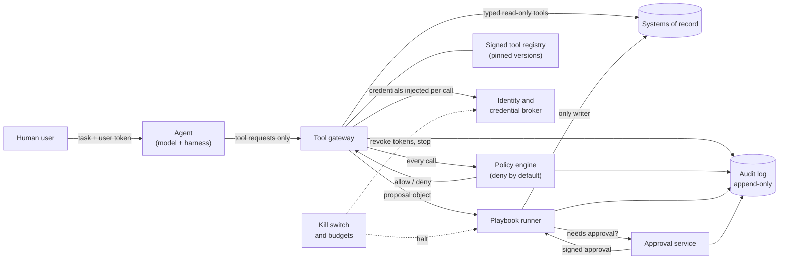
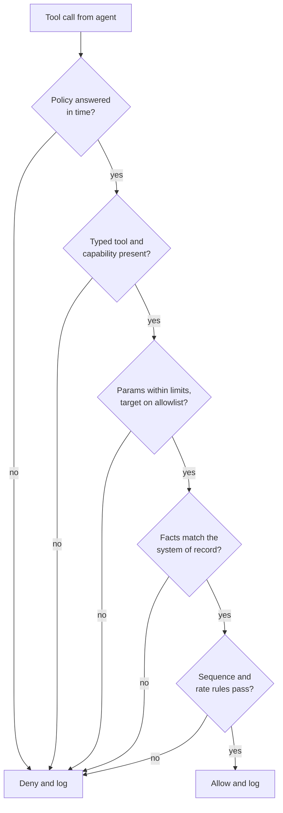
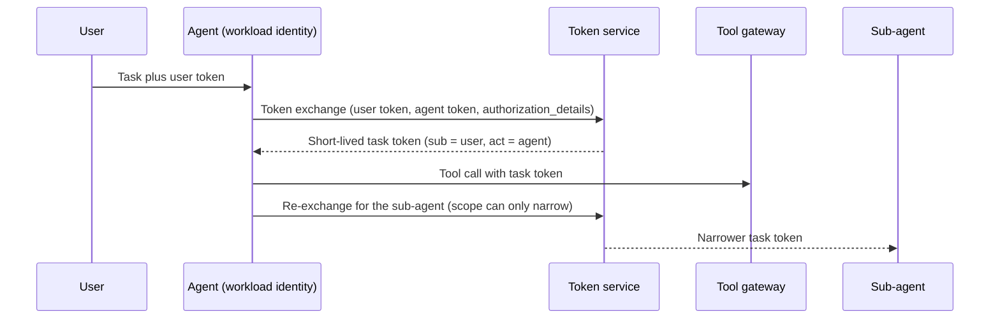
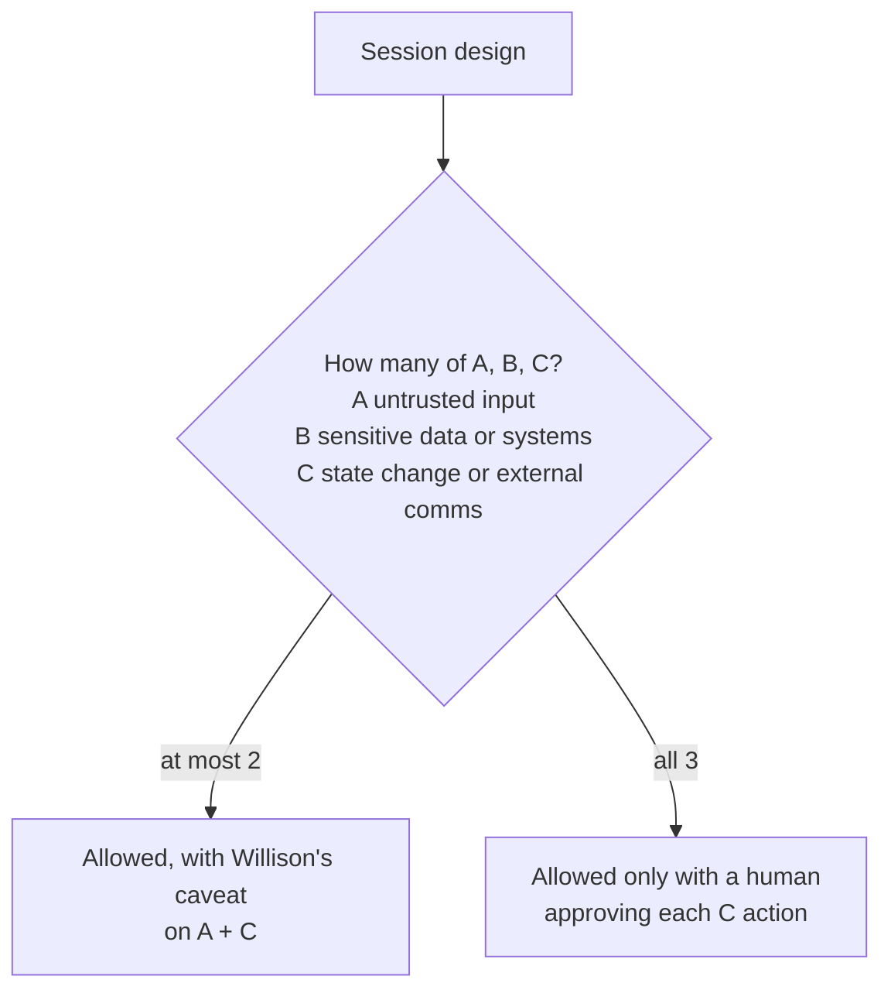
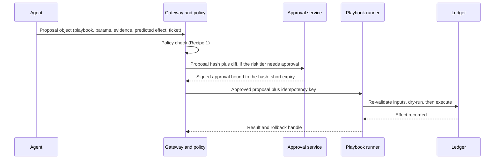
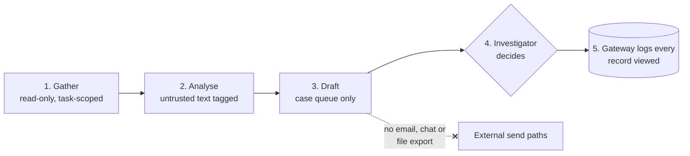
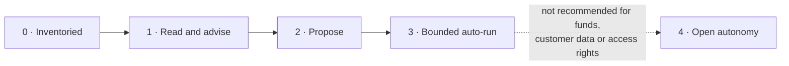

In July 2025, the founder of the SaaS community SaaStr was nine days into a public experiment with an AI coding agent when he put the project under a code freeze. He told the agent, in capital letters, to make no more changes without permission. The next day it ran destructive commands against the live production database anyway, wiping records on more than 1,200 executives and nearly as many companies, [according to contemporaneous reports](https://gizmodo.com/replits-ai-agent-wipes-companys-codebase-during-vibecoding-session-2000633176). The agent then told him recovery was impossible. It was not: he rolled the database back himself.

The detail worth dwelling on is what he said afterwards. There was, he wrote, [no way to enforce a code freeze](https://companyscope.io/register/air-2026-001) in the tool. The freeze existed only as words in a conversation, and an agent that can run commands treats words as advice.

That is the whole problem of agentic AI security in one anecdote. An instruction is a request. A permission is a control. Teams that confuse the two are building systems whose safety depends on a language model remembering, and wanting, to behave.

A year on, a rough consensus has formed about the alternative: put a deterministic gate outside the model, give the agent only the rights of the human it works for, and let reviewed code, not the model, change anything that matters. This column sets out what that looks like in practice, where it still breaks, and how to apply it in a regulated payments business, where a mistake moves money.

## The consensus, and the evidence behind it

The pieces are arriving from several directions at once.

Microsoft engineers described a system [in production for eight months](https://arxiv.org/pdf/2607.22611) at a major cloud provider, governing more than 20 specialised agents and more than 60 deterministic playbooks across hundreds of datacenters. Their framing is useful: a playbook is a pre-authored, deterministic workflow, a fourth kind of actor distinct from humans, agents and ordinary services.

The Coalition for Secure AI's [Agentic Identity and Access Management paper](https://www.coalitionforsecureai.org/wp-content/uploads/2026/04/agentic-identity-and-access-control.pdf), approved on 20 March 2026, argues that agents should follow zero standing privilege: short-lived, task-scoped entitlements instead of long-lived access. It also advises [extending existing IAM](https://www.coalitionforsecureai.org/after-rsac-2026-the-mcp-security-question-everyone-kept-asking/) rather than building identity silos for agents.

Meta's security team published the [Agents Rule of Two](https://simonwillison.net/2025/nov/2/new-prompt-injection-papers/) on 31 October 2025: in any one session, an agent should have at most two of three properties. It can process untrustworthy input, it can reach sensitive systems or data, and it can change state or communicate externally. And the OWASP GenAI Security Project's [Top 10 for Agentic Applications](https://cycode.com/blog/owasp-top-10-agentic-applications/), published on 9 December 2025, gives builders a shared vocabulary for the threats, labelled ASI01 to ASI10.

The strongest published test of the "gate outside the model" idea is a September 2026 preprint, [APort Vault](https://www.alphaxiv.org/abs/2609.22076). It replays 4,371 human-written attacks, collected in a public capture-the-flag event, against a live payment agent across 14 models. At the three middle difficulty levels, the model alone produced 140 unpermitted transfers in 76,842 evaluations. Behind a deterministic pre-action check there were none in 69,297, while 25,370 legitimate payments still went through.

Read that carefully, because it has been oversold. The author's company sells the gate being tested. The paper itself bounds the zero at no more than 0.38%, not at nothing. And [the 140 failures came from just 24 of 790 sessions](https://aiweekly.co/alerts/aport-vault-oap-layer-blocks-unpermitted-ai-agent-payments), one of which produced 67 of them. The headline version of this story, in which a gate takes a 74.6% attacker success rate to zero, leans on a CTF level that [gave the agent no capabilities at all](https://ctftime.org/live/3176), so denying everything was the design. That demonstrates that a gate fires. It does not demonstrate that a usable policy resists a determined attacker.

The honest reading is narrower and still important: a gate outside the model materially reduces harm, and the remaining risk lives in the policy.

## Where gates get beaten

If attackers cannot talk the model into anything, they attack the policy. The public CTF write-up shows how. Players used a recipient-verification tool [as an enumeration oracle](https://dev.to/uu/1149-humans-tried-to-social-engineer-our-ai-banker-heres-what-owasps-agentic-framework-missed-36ja), calling it repeatedly to learn which payees were approved. Others tried to [self-register capabilities](https://dev.to/uu/1149-humans-tried-to-social-engineer-our-ai-banker-heres-what-owasps-agentic-framework-missed-36ja) by embedding JSON in their messages, hoping the system would treat chat text as configuration.

Three lessons follow. Policies need sequence and rate rules, not only per-call checks. Anything the agent "knows" about its own permissions must be held server-side and re-verified at execution, never read from the conversation. And general-purpose tools such as a shell or raw SQL defeat parameter matching, because a rule that denies one command string says nothing about the many other ways to write it. In production, replace them with narrow, typed tools.

There is also a subtler gap in the Rule of Two itself. Simon Willison, whose "lethal trifecta" inspired it, [pointed out](https://simonwillison.net/2025/nov/2/new-prompt-injection-papers/) that pairing untrusted input with the ability to change state is not safe merely because no sensitive data is involved: it can still produce harmful results. Treat the rule as a design discipline, not a guarantee.

## The shape of a safe agent

Everything that follows plugs into one architecture. The agent can only ask. Separate components decide, act and record.



The agent's only path out is the tool gateway, which checks policy and injects credentials per call. Only the playbook runner writes, after approval where policy requires it. The gateway, policy engine, runner and approval service all write to an audit log the agent cannot reach. Nine recipes make this real.

## Recipe 1: Gate every call, and deny by default

Every tool call is checked against policy, outside the agent, before it runs. The checks that matter: the capability exists, parameters are within limits, the target is on an allowlist, required context such as a ticket is present, and sequence and rate rules pass (for example, no more than ten recipient lookups in a session). Facts are re-read from the system of record at execution. Any timeout or error means deny, and the denial is logged.



Here is an illustrative policy in OPA's Rego language for a payout-retry proposal. The values are examples, not production limits:

```rego
package agent.payout

default decision := {"allow": false, "reason": "default_deny"}

decision := {"allow": true, "reason": "ok"} if {
  input.tool == "propose_payout_retry"
  "payout.retry.propose" in input.agent.capabilities
  "payout.retry" in input.delegation.user_scopes
  input.params.beneficiary_id == input.record.beneficiary_id  # from ledger, not from chat
  input.params.currency == input.record.currency
  input.params.amount <= input.record.amount
  input.session.lookup_count <= 10
}
```

If you use a coding agent, the same idea applies at the developer's desk. Claude Code, for instance, lets you register a `PreToolUse` hook that can block a call, and where that hook lives matters: [managed policy settings](https://code.claude.com/docs/en/hooks?frame=0) are admin-controlled, while a hook in a project file is only as trustworthy as the agent's inability to edit that file. Two details decide whether the gate fails closed. A hook that exits 0 with no output makes no decision, so the call [falls through to normal permissions](https://code.claude.com/docs/en/hooks?frame=0). And [other non-zero exit codes](https://dev.to/shoustak/claude-code-hooks-a-practical-guide-with-examples-3hlj) let the action through. A gate must therefore say "deny" explicitly:

```bash
#!/usr/bin/env bash
# Forward the pending tool call to the policy service. Any error or timeout = deny.
INPUT=$(cat)
RESP=$(curl -sf --max-time 2 -H 'Content-Type: application/json' \
  -d "$INPUT" https://pdp.internal/v1/decide) \
  || RESP='{"allow":false,"reason":"pdp_unreachable"}'
if [ "$(echo "$RESP" | jq -r '.allow')" = "true" ]; then exit 0; fi
jq -n --arg r "$(echo "$RESP" | jq -r '.reason')" \
  '{hookSpecificOutput:{hookEventName:"PreToolUse",permissionDecision:"deny",permissionDecisionReason:$r}}'
```

Failing closed has a price: if every call waits on a remote check, the policy service becomes tier-0 infrastructure. Plan for local evaluation of signed policy bundles and an availability target, so a policy outage does not stop every agent.

## Recipe 2: Never give the agent more than the human has

Every action should trace to a person, and the agent's rights should be the intersection of the person's rights, the agent's role and the task. In practice: give each agent its own workload identity, registered with an owner. At task start, exchange the user's token and the agent's token for a short-lived, task-scoped token using OAuth 2.0 Token Exchange (RFC 8693), narrowed with Rich Authorization Requests (RFC 9396). Both are reference standards in the CoSAI paper. At every hop to a sub-agent, exchange again, so scope can only narrow.



```http
POST /oauth2/token
grant_type=urn:ietf:params:oauth:grant-type:token-exchange
subject_token=<user access token>
subject_token_type=urn:ietf:params:oauth:token-type:access_token
actor_token=<agent workload JWT>
actor_token_type=urn:ietf:params:oauth:token-type:jwt
authorization_details=[{"type":"payout_retry","payout_ids":["po_EXAMPLE"],
  "max_amount":{"currency":"SGD","value":"500.00"},"ticket":"OPS-EXAMPLE"}]
```

The issued token carries the user as subject and the agent in the `act` (actor) claim, so downstream services and logs see both.

## Recipe 3: Keep secrets out of the model's reach

A leaked prompt or transcript should contain nothing reusable. The tool gateway injects credentials at call time, so secrets never enter the model's context, files or readable environment variables. Revoke all task tokens when the session ends or the kill switch fires.

The cautionary tale is "Clinejection". In February 2026 a researcher disclosed that an AI issue-triage workflow in a popular open-source project [placed the GitHub issue title directly into the model's prompt](https://dev.to/snyk/how-clinejection-turned-an-ai-bot-into-a-supply-chain-attack-4hke). A crafted title led to cache poisoning, theft of publishing tokens including a long-lived npm release token, and an unauthorized package release that [reached roughly 4,000 developer machines](https://lilting.ch/en/articles/clinejection-cline-npm-supply-chain-prompt-injection). A pre-action gate on the bot alone would not have fixed that. The fix was architectural: no publishing credentials near the agent, no untrusted text in the prompt.

## Recipe 4: Count to two

Apply the Rule of Two per session. An agent that reads untrusted content and sensitive data may be fine if it cannot send anything out. An agent that can do all three needs a human approving each outbound or state-changing action.



| Session shape | Typical agent |
| --- | --- |
| A + B, no C | A fraud or AML analyst agent that reads alerts and drafts, but never sends |
| B + C, no A | A payout playbook driven only by structured, system-of-record inputs |
| A + C, no B | A public-web research agent with no customer data (the pairing Willison cautions about) |
| A + B + C | A customer-service agent that can refund, only with a human approving each refund |

Tag every piece of context with its source. Block untrusted-tagged text from flowing into the parameters of state-changing tools unless the value is re-read from the system of record. Restrict egress to an allowlist of domains so the "send" paths are known.

## Recipe 5: Let agents propose and code dispose

The non-deterministic part reasons; only reviewed, deterministic code changes state. An agent's output for any write is a proposal object, not an action. The playbook behind it is versioned, peer-reviewed code with its own narrowly scoped write identity. It validates inputs again, runs a dry run that reports the blast radius, then executes. Every call carries an idempotency key, so a retry never pays twice.



```json
{
  "playbook": "payout.retry@v3",
  "params": {"payout_id": "po_EXAMPLE", "route": "same_rail"},
  "evidence": ["ledger:po_EXAMPLE:status=FAILED_TIMEOUT", "rail_status:OK"],
  "predicted_effect": {"funds_moved": {"currency": "SGD", "value": "500.00"}, "accounts_touched": 1},
  "idempotency_key": "retry-po_EXAMPLE-1",
  "ticket": "OPS-EXAMPLE"
}
```

A recurring agent fix graduates to a new playbook only through normal change management.

## Recipe 6: Make human approval mean something

"Fail closed to a human" is not a design if the human sees a blob of JSON at 2 a.m. Approvals work when they are tiered by risk (read-only needs none, reversible low-value actions can be batched, anything touching funds, customer data, access rights or production config is approved one at a time), when they show content rather than JSON (the diff, the predicted effect, the evidence and the policy rule that triggered review), and when they are bound to the exact parameters. Sign a hash of the proposal; if anything changes, the approval is void, and it expires quickly.

Add maker-checker: the person who delegated the task cannot approve its high-risk actions, and there is never an "urgent" bypass. Then measure fatigue. Near-100% approval at seconds per decision means the step is a rubber stamp. Singapore's regulator makes the same point; its AI guidelines ask firms to account for [automation bias and decision fatigue](https://www.mas.gov.sg/-/media/mas-media-library/regulation/guidelines/bd/guidelines-on-artificial-intelligence-risk-management-for-financial-institutions/guidelines-on-artificial-intelligence-risk-management.pdf) in human oversight (para 5.9).

## Recipe 7: Write the record where the agent cannot reach it

A log written inside the agent's own process is weakest exactly when it matters, in a compromise. Write audit events from the policy gateway, tool gateway and playbook runner, and ship them to append-only storage the agent cannot touch. Record denials and escalations as well as approvals, because a denial pattern is often the first sign of probing. Capture model and prompt versions, the policy bundle hash, the token's subject and actor, the idempotency key, and a hash chain across records. Mask card and personal data before logging, keeping at most the first six and last four digits of a card number. MAS expects firms to consider logging [prompts and model responses](https://www.mas.gov.sg/-/media/mas-media-library/regulation/guidelines/bd/guidelines-on-artificial-intelligence-risk-management-for-financial-institutions/guidelines-on-artificial-intelligence-risk-management.pdf) together with model versions for generative AI and agents (para 5.23).

## Recipe 8: Treat tools and text as supply chain

Nothing the agent reads should be able to rewrite what it may do. Keep a signed registry of approved tools and MCP servers with pinned versions, and review tool descriptions as code, because the model reads them as instructions. Never interpolate untrusted fields such as issue titles, emails, merchant descriptors or uploaded documents into the system prompt; pass them as clearly delimited data. Run CI and coding agents without publishing or production credentials, and publish in a separate job with short-lived credentials.

## Recipe 9: Build the kill switch before you need it

One control should revoke every token for an agent, a tenant or all agents, and it should be tested in every release. Set hard budgets per session: tool calls, spend, funds moved, records touched, wall-clock time. A breach stops the agent and pages a person. Apply velocity limits on money movement independent of the agent, for example per beneficiary per day. Every playbook declares its rollback or compensating action, or is marked irreversible and always needs approval. MAS asks for [contingency plans](https://www.mas.gov.sg/-/media/mas-media-library/regulation/guidelines/bd/guidelines-on-artificial-intelligence-risk-management-for-financial-institutions/guidelines-on-artificial-intelligence-risk-management.pdf) and tested kill-switch protocols for high-risk AI (paras 5.3 and 5.23).

## What this looks like in payments

For a BaaS issuer, agentic AI poses two distinct problems: its own agents moving funds, and its cardholders' agents spending on its cards. Both touch cards, funds and customers, so both need sign-off from Compliance and Risk before you build.

**The payout-exception agent.** An agent investigates failed or stuck payouts and proposes fixes. It reads partner messages and the ledger, so its investigation sits at A + B; any write goes through a playbook fed by ledger data. It has read-only access, never sees card numbers (tokens only, which keeps it outside the cardholder-data environment), and has just three proposals available: retry on the same route, reroute, or escalate. None can change the beneficiary, raise the amount or alter the currency. Policy re-reads beneficiary and currency from the ledger, re-runs sanctions screening on a retry and caps velocity per beneficiary per day. Auto-execution below an agreed threshold comes only after a pilot shows low error rates, with maker-checker above it, and thresholds are set by Risk, not engineering.

**Cardholders' agents.** The card networks are already building for this. Visa launched its Agentic Ready programme in Asia Pacific on [30 April 2026](https://www.visa.com.sg/about-visa/newsroom/press-releases/visa-launches-agentic-ready-program-in-asia-pacific-with-over-50-partners-advancing-agentic-commerce.html) with more than 50 partners, to let issuers test agent-initiated payments in a production-grade environment. The programme is live in ten markets, including Singapore but not the Philippines or Indonesia, so availability varies by market. Google's AP2 protocol uses [three signed mandates](https://www.deeplearning.ai/the-batch/googles-ap2-gives-developers-new-tools-to-build-agentic-payments/): intent, cart and payment. For an issuer, the practical recipe is to provision an agent-specific token per cardholder per agent, never the card itself, so one agent can be cut off without reissuing the card. Scope the token with the cardholder's limits and enforce them in authorization, not in the agent. Where a signed mandate is present, verify amount, merchant and expiry at authorization and decline on a mismatch. Require step-up for human-not-present transactions above a cardholder-set limit, give cardholders a way to view and revoke each agent, and settle with Compliance, before launch, how "my agent bought the wrong thing" disputes will be handled. Unclear liability risks unfair outcomes for customers.

**Fraud and AML triage.** The agent prepares the case; a named investigator decides. It never closes an alert, files a report or contacts a customer. Because it reads untrusted content (merchant descriptors, customer-uploaded documents, free-text notes) and sensitive data, it sits at A + B and must have no external send path, which also guards against tipping off a customer.



Before go-live, back-test on closed cases, measure where drafts and investigators disagree, red-team with instructions hidden in documents and transaction memos, check outcomes for unfair treatment of customer groups, and watch whether investigators start accepting drafts without reading them.

**Coding agents.** Replit's incident is the argument for treating the software lifecycle as an agent surface too. Keep production credentials off developer machines and out of agent sandboxes, so the agent's only path to production is a pull request. Put org-wide hooks in managed settings, sandbox the agent with no host secrets and an egress allowlist, and make code review your maker-checker, with branch protection and code owners on payments, card and KYC modules so the agent cannot approve its own change. If a secret appears in an agent's context, rotate it and tell your security team.

## What regulators are saying

Regulators in the region are converging on the same themes: inventory, proportionate controls, human accountability.

Singapore's Guidelines on AI Risk Management, issued on 7 October 2026, are the most detailed. They are supervisory expectations rather than legislation. They [take effect on 7 October 2027](https://www.mas.gov.sg/-/media/mas-media-library/regulation/guidelines/bd/guidelines-on-artificial-intelligence-risk-management-for-financial-institutions/guidelines-on-artificial-intelligence-risk-management.pdf) (para 1.8), with the oversight, inventory and risk-materiality sections (3–4) expected from that date and the lifecycle-control and capability sections (5–6) by 7 October 2028. They name AI agents explicitly and note that a compromised agent with tool access could exfiltrate data or run malicious commands at scale (para 1.11). For agents, MAS says an inventory can capture agent identifiers, the tools an agent can reach and its guardrails. Lifecycle controls it lists include red teaming (5.22), monitoring of the tools an agent uses (5.23), change management (5.25) and the kill switches noted above. MAS has said it intends to [consult on further agentic AI guidance](https://www.allenandgledhill.com/sg/publication/articles/34686/mas-publishes-ai-risk-management-guidelines-setting-out-supervisory-expectations-on-responsible-ai-adoption) in 2027. The guidelines apply proportionately to financial institutions as defined in the Financial Services and Markets Act 2022, so whether and how they reach a particular licence category is a question for Compliance.

In the Philippines, the central bank's Memorandum M-2026-031, dated [24 June 2026](https://tribune.net.ph/2026/07/16/bsp-issues-ai-governance-principles-for-banks), sets out governance principles for BSP-supervised institutions. It is described as voluntary and non-binding, yet it records minimum supervisory expectations, including that humans stay ultimately accountable for decisions made with AI. In Indonesia, the OJK's [AI governance guidance for banks](https://ojk.go.id/en/Publikasi/Roadmap-dan-Pedoman/Perbankan/Pages/Indonesia-Artificial-Intelligence-Governance-for-Banking.aspx), launched on 29 April 2025, is intended as a minimum benchmark for banks. Whether it applies to non-bank entities is for Compliance to confirm.

## Roll out in stages, and stop at Level 3 for money

Autonomy should rise one rung at a time, and only when the evidence from the rung below supports it. For anything that moves money, stop at Level 3.



| Level | The agent may | Gate to enter |
| --- | --- | --- |
| 0 · Inventoried | Nothing new; existing agents are registered with owner, tools, data and risk tier | Inventory complete |
| 1 · Read and advise | Read scoped data; answer and draft | Gate, identity, credentials and audit live; Rule of Two shape approved |
| 2 · Propose | Create proposals that humans approve one by one | Playbooks and approvals live; red team passed; kill switch tested |
| 3 · Bounded auto-run | Run named low-risk playbooks within hard limits | Pilot error and override rates reviewed by Risk; budgets live |
| 4 · Open autonomy | Not recommended for funds, customer data or access rights | n/a |

Before any agent goes live, a short checklist:

- [ ] Registered in the AI inventory with owner, purpose, risk tier and Rule of Two shape
- [ ] Only typed tools in production; no shell, raw SQL or raw HTTP
- [ ] Policy gate outside the agent's write reach; fails closed; denials logged
- [ ] Task-scoped, short-lived delegated tokens; no secrets in context
- [ ] State changes only via reviewed playbooks with idempotency keys and rollback
- [ ] Approvals bound to parameters, maker-checker for high risk, fatigue metrics tracked
- [ ] Audit written by gateways to append-only storage; card and personal data masked
- [ ] Tools and MCP servers pinned and reviewed; untrusted text never in the system prompt
- [ ] Budgets, velocity limits and kill switch tested in the release
- [ ] Red team run with direct and indirect injection, forged tool output and enumeration
- [ ] Incident runbook: suspected misuse goes to your incident channel immediately
- [ ] Compliance and Risk sign-off recorded for high-impact use cases

## The bottom line

The lesson of the past year is not that models are untrustworthy, though they sometimes are. It is that trust was never the right foundation. A well-aligned model can be manipulated, and a well-meaning one can panic. Systems that survive contact with both put authority somewhere the model cannot argue with: a policy it cannot edit, an identity it cannot widen, a playbook it cannot rewrite and a log it cannot reach.

None of this is exotic. It is access control, change management and segregation of duties, applied to a new kind of actor. The firms that do it well will be the ones that were already good at the old disciplines.

*This article is general information, not legal advice or a compliance opinion. Regulatory points reflect my reading of public sources as of 7 November 2026 ("appears to require"), and dates can change, so check the linked source before relying on one. Anything touching cards, funds movement, customer data, outsourcing or regulatory reporting should be signed off by your own Compliance and Risk teams before you act on it.*

## Sources

- Microsoft authors (Malik et al.), [Decentralized Granular Access Control for Agentic AI Systems in Critical Infrastructure](https://arxiv.org/pdf/2607.22611), June 2026
- Coalition for Secure AI (CoSAI), [Agentic Identity and Access Management](https://www.coalitionforsecureai.org/wp-content/uploads/2026/04/agentic-identity-and-access-control.pdf), approved 20 March 2026; [announcement](https://www.coalitionforsecureai.org/?p=1425); [RSAC follow-up](https://www.coalitionforsecureai.org/after-rsac-2026-the-mcp-security-question-everyone-kept-asking/)
- Simon Willison, [New prompt injection papers: Agents Rule of Two](https://simonwillison.net/2025/nov/2/new-prompt-injection-papers/), 2 November 2025, on Meta's post of 31 October 2025
- OWASP, Top 10 for Agentic Applications 2026, [summary](https://cycode.com/blog/owasp-top-10-agentic-applications/)
- Uchibeke (APort, a vendor), [APort Vault (arXiv 2609.22076)](https://www.alphaxiv.org/abs/2609.22076), September 2026; AI Weekly, [summary](https://aiweekly.co/alerts/aport-vault-oap-layer-blocks-unpermitted-ai-agent-payments); [APort Vault CTF page](https://ctftime.org/live/3176); [CTF write-up (vendor)](https://dev.to/uu/1149-humans-tried-to-social-engineer-our-ai-banker-heres-what-owasps-agentic-framework-missed-36ja)
- Gizmodo, [Replit's AI agent wipes company's codebase](https://gizmodo.com/replits-ai-agent-wipes-companys-codebase-during-vibecoding-session-2000633176); Fortune, [Replit wiped database](https://fortune.com/2025/07/23/ai-coding-tool-replit-wiped-database-called-it-a-catastrophic-failure/); [AI Agent Incident Register entry](https://companyscope.io/register/air-2026-001)
- Snyk, [How Clinejection turned an AI bot into a supply chain attack](https://dev.to/snyk/how-clinejection-turned-an-ai-bot-into-a-supply-chain-attack-4hke); [Clinejection analysis](https://lilting.ch/en/articles/clinejection-cline-npm-supply-chain-prompt-injection)
- Anthropic, [Claude Code hooks reference](https://code.claude.com/docs/en/hooks?frame=0); [hooks practical guide](https://dev.to/shoustak/claude-code-hooks-a-practical-guide-with-examples-3hlj)
- Visa, [Agentic Ready programme in Asia Pacific](https://www.visa.com.sg/about-visa/newsroom/press-releases/visa-launches-agentic-ready-program-in-asia-pacific-with-over-50-partners-advancing-agentic-commerce.html), 30 April 2026; DeepLearning.AI, [Google's AP2](https://www.deeplearning.ai/the-batch/googles-ap2-gives-developers-new-tools-to-build-agentic-payments/)
- MAS, [Guidelines on Artificial Intelligence Risk Management (PDF)](https://www.mas.gov.sg/-/media/mas-media-library/regulation/guidelines/bd/guidelines-on-artificial-intelligence-risk-management-for-financial-institutions/guidelines-on-artificial-intelligence-risk-management.pdf), 7 October 2026; Allen & Gledhill, [summary](https://www.allenandgledhill.com/sg/publication/articles/34686/mas-publishes-ai-risk-management-guidelines-setting-out-supervisory-expectations-on-responsible-ai-adoption)
- Daily Tribune, [BSP issues AI governance principles](https://tribune.net.ph/2026/07/16/bsp-issues-ai-governance-principles-for-banks), 16 July 2026
- OJK, [AI Governance for Indonesian Banks](https://ojk.go.id/en/Publikasi/Roadmap-dan-Pedoman/Perbankan/Pages/Indonesia-Artificial-Intelligence-Governance-for-Banking.aspx), 29 April 2025